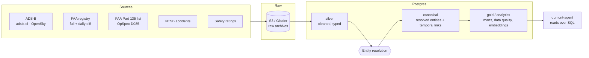

# osa-data-platform

[](https://github.com/PhelipeHonesto/osa-data-platform/actions/workflows/ci.yml)


**The data layer for private aviation.** This repo ingests ADS-B flight tracks, the FAA aircraft registry, FAA Part 135 certificate data, and NTSB accident records. It resolves them into one canonical graph of who operates which aircraft, under which certificate, and since when.

The hard problem isn't collecting the data. It's that the name on an aircraft's registration is often not the company that flies it. `BANK OF UTAH TRUSTEE` holds more than 1,500 airframes on behalf of the big fractional and charter fleets. Brands change while certificates persist, and one operator group can hold several certificates. This platform models those relationships explicitly instead of guessing.

---

## At a glance

| | |
| --- | --- |
| **Completed flight legs** | 21,003,038 in `adsb_completed_legs`, rebuilt from raw archives |
| **FAA registry** | 314,813 aircraft rows, plus the daily diff, document index, and airmen |
| **Distinct ADS-B airframes** | 121,512 in flight history |
| **NTSB** | Accident records from 1962 to present |
| **Tests** | 484 passing, 10 opt-in live-data tests ([how](#evidence)) |

## Architecture



### Six entities, nothing more until each one resolves

| Entity | What it is | Example |
| --- | --- | --- |
| **Operator** | The commercial brand | NetJets, VistaJet |
| **Certificate** | The legal FAA authority to fly for hire | a Part 135 certificate designator |
| **Aircraft** | The physical airframe, identified by ICAO hex rather than N-number | N-numbers get reused; hex codes don't |
| **FBO** | Ground service location | |
| **Airport** | Geography | |
| **Person** | Pilot, owner, executive, broker | |

Every relationship between them is a **temporal link** with `valid_from`, `valid_to`, `source`, and `evidence`. Links are written append-only, close-then-insert, from an events log, so the graph can answer "who operated this aircraft on March 3rd?" and not only "who operates it now?". See [`docs/temporal-link-pattern.md`](docs/temporal-link-pattern.md).

### Entity resolution

- **Matching:** Jaro-Winkler plus trigram similarity over normalized names, with field-priority rules and calibrated thresholds ([`src/entity-resolution/`](src/entity-resolution/))
- **Pre-filters:** trustee and leasing holders are routed out *before* matching, so a bank never gets merged into the airline it holds title for
- **Trust scores** are shown on every claim and never used to filter it
- **Two-source rule (specified, on the roadmap):** rebrands, acquisitions, and certificate transfers will need two independent sources before they reach the canonical layer. Single-source claims wait in a review queue.
- **LLM pass for the residue:** names the deterministic matcher can't settle go to a model that must cite web evidence or say `new_entity` or `ambiguous`

## Evidence

The LLM resolution pass was gated on an adversarial eval before it ran on the 352-record work queue ([`docs/phase-2-eval-summary.md`](docs/phase-2-eval-summary.md); raw runs in [`.work/llm-er-pass/`](.work/llm-er-pass/)):

| Gate | Result |
| --- | --- |
| False matches when the true answer was hidden from the candidate list | **0 / 9** |
| Fabricated operator IDs | **0 / 19** |
| Genuine LLM errors in visible mode | **0**. Every miss was either a pipeline false-positive the model correctly rejected or a real name collision |

The model also caught a bug in the deterministic matcher, which had merged "Executive *Flight* Management" (one Baron 58P in Illinois) into "Executive *Jet* Management" (a NetJets subsidiary).

| Check | Command |
| --- | --- |
| Unit and integration tests: 484 pass, 10 skipped | `npm test` |
| Live-data tests against faa.gov and the S3 archive (need network and AWS credentials) | `RUN_LIVE_TESTS=1 npm test` |
| Type check | `npm run typecheck` |
| Layer isolation (this repo must never grow agent code) | `npm run lint:layers` |

Every schema migration is verified three ways before it counts as shipped: a local up/down/up rollback test, the production migrate, and a direct query proving the object exists in production. [`CLAUDE.md`](CLAUDE.md) explains why that third step exists.

## Quickstart

Requires Node 22.

```bash
npm install
npm test
npm run typecheck
```

Pipelines need `SUPABASE_DATABASE_URL` (Postgres) and, for archives, AWS credentials.

```bash
DATABASE_TYPE=postgres npm run pipeline       # nightly orchestrated run
DATABASE_TYPE=postgres npm run faa:diff       # FAA registry daily diff
DATABASE_TYPE=postgres npm run quality:check  # data-quality rules
```

## Repository map

```
src/ingestion/          ADS-B, FAA, D085, NTSB, safety-ratings ingestion + live workers + archivers
src/entity-resolution/  matchers, thresholds, pre-filters, trust scoring
src/analytics/          market engine, data quality, embeddings
schema/                 SQL source of truth: silver → canonical → gold, migrations, rollbacks
docs/                   architecture, ER specs, ADRs, eval reports, runbooks
scripts/                backfills, calibration, dedup, verification
tests/                  Vitest suite
```

Start with [`docs/er-architecture-plan.md`](docs/er-architecture-plan.md) for the model, [`docs/data-sources.md`](docs/data-sources.md) for source tiers and the sources that are permanently excluded, and [`docs/decisions/`](docs/decisions/) for ADRs.

## Status

Operator resolution is done. Aircraft resolution is shipped: schema, registry backfill, and callsign walk. Certificate is specced in [`docs/er/certificate.md`](docs/er/certificate.md). FBO, airport, and person are next. Known data gaps are tracked publicly in [`docs/known-issues.md`](docs/known-issues.md).

## Part of the OSA stack

| Repo | Role |
| --- | --- |
| [dumont-agent](https://github.com/PhelipeHonesto/dumont-agent) | Charter-brokerage agent that reasons over this data |
| **osa-data-platform** (this repo) | Ingestion, entity resolution, analytics |
| [ph-brain-engine](https://github.com/PhelipeHonesto/ph-brain-engine) | Long-term memory substrate served over MCP |
| [Aviation-News-Aggregator](https://github.com/PhelipeHonesto/Aviation-News-Aggregator) | Loud Hawk: aviation news and signals |

## License

The source is public for review. No license to use it is granted.
